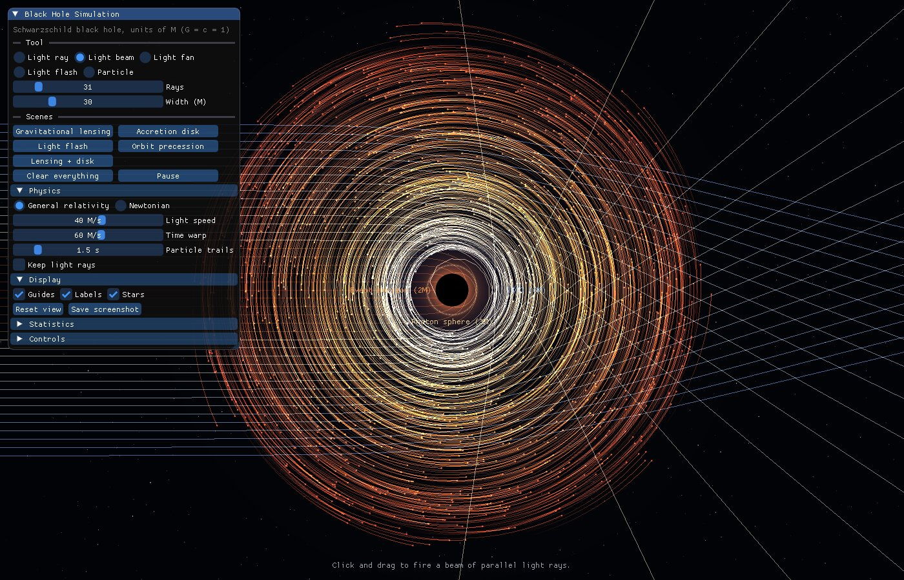
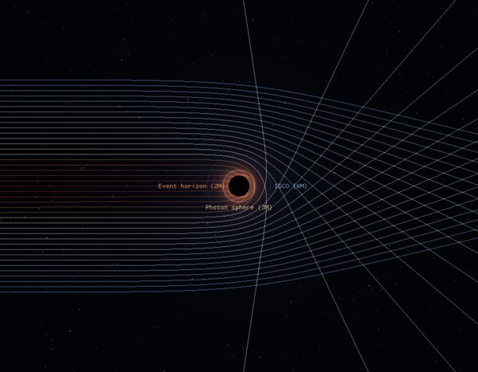
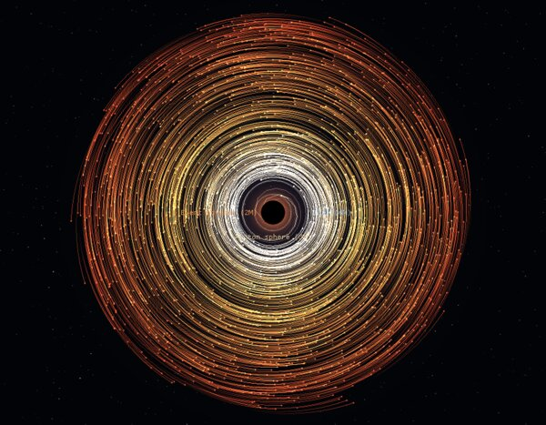
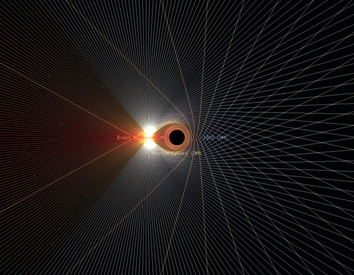
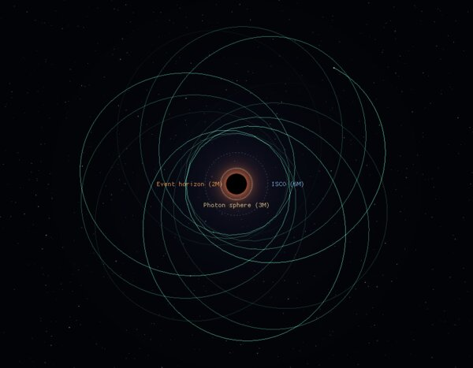

<div align="center">

# 🕳️ Black Hole Simulation

**An interactive 2D simulation of light and matter around a black hole, using the equations of general relativity.**

[](https://isocpp.org/)
[](https://www.opengl.org/)
[](https://cmake.org/)
[](#-building)



</div>

---

## ✨ Features

- **Light bending.** Fire light rays, parallel beams, fans or flashes of light, and watch them curve around the black hole, get captured, or circle the photon sphere.
- **Orbiting matter.** Throw particles into orbit or spawn a full accretion disk. Orbits precess, and matter that gets inside the ISCO spirals in.
- **Real physics.** Particles and light follow exact Schwarzschild geodesics, integrated with 4th-order Runge–Kutta.
- **Relativity vs. Newton.** Switch to classical gravity with one key to see what Einstein changed: light bends half as much, orbits stop precessing and the ISCO disappears.
- **Trajectory preview.** While aiming, a dotted line shows where a ray or particle will go.
- **Unit-tested.** The integrators are checked against analytic results of general relativity.

## 🖼️ Gallery

| Gravitational lensing | Accretion disk | Light flash | Orbit precession |
|:---:|:---:|:---:|:---:|
|  |  |  |  |
| Parallel light rays bend around the hole and cross behind it. Rays that come too close are captured. | 1,800 particles on near-circular orbits. Those that drift inside 6M spiral in. | Light emitted in every direction from 7M. Some rays circle the hole before escaping. | An eccentric orbit whose closest point rotates every turn, like Mercury's but much stronger. |

---

## 🔨 Building

### Requirements

- A **C++17 compiler** (GCC 9+, Clang 10+, or Visual Studio 2019+)
- **CMake 3.16+**
- **Git** (CMake uses it to download dependencies)
- A GPU or driver with **OpenGL 3.3** support

GLFW, Dear ImGui and stb are downloaded automatically during configuration. If GLFW is already installed on your system, that copy is used instead.

### Linux

Install the build tools and the libraries GLFW needs:

```bash
# Ubuntu / Debian
sudo apt install build-essential cmake git libglfw3-dev
```

```bash
# Fedora
sudo dnf install gcc-c++ cmake git glfw-devel
```

Then build:

```bash
git clone https://github.com/Wasauski669/Black-hole-Simulation.git
cd Black-hole-Simulation
cmake -B build -DCMAKE_BUILD_TYPE=Release
cmake --build build -j
```

### macOS

```bash
brew install cmake glfw
cmake -B build -DCMAKE_BUILD_TYPE=Release
cmake --build build -j
```

### Windows

With Visual Studio 2019 or newer (including "Desktop development with C++") and CMake installed:

```bash
cmake -B build
cmake --build build --config Release
```

The program is then at `build\Release\blackhole.exe`. You can also open the folder in Visual Studio directly: it detects `CMakeLists.txt` automatically.

---

## ▶️ Running

```bash
./build/blackhole
```

Or start directly into one of the scenes:

```bash
./build/blackhole --scene both
```

| Option | Description |
|---|---|
| `--scene <name>` | Load a scene at startup: `lensing`, `disk`, `flash`, `precession`, `both` |
| `--size <W>x<H>` | Window size, e.g. `1920x1080` (default `1280x800`) |
| `--no-ui` | Start with the control panel hidden |
| `--frames <n>` | Run a fixed number of frames, then exit |
| `--screenshot <file>` | Together with `--frames`: save the last frame as a PNG |

---

## 🎮 Controls

| Input | Action |
|---|---|
| **Left mouse** | Use the current tool (click, or drag to aim) |
| **Right / middle mouse** | Pan the view |
| **Mouse wheel** | Zoom in and out around the cursor |
| `1` – `5` | Select a tool: ray, beam, fan, flash, particle |
| `Space` | Pause / resume |
| `N` | Switch between general relativity and Newtonian gravity |
| `D` | Add an accretion disk |
| `C` | Clear everything |
| `G` / `L` | Show or hide guides / labels |
| `R` | Reset the view |
| `P` | Save a screenshot (PNG in the current folder) |
| `H` | Hide or show the control panel |
| `Esc` | Quit |

### Tools

| Tool | How to use it |
|---|---|
| 🔦 **Light ray** | Press where the ray starts and drag in the direction it should travel. |
| 🌊 **Light beam** | Same, but fires many parallel rays. The width and number of rays are set in the panel. |
| 🔆 **Light fan** | Fires rays from a single point, spread over an angle. |
| 💥 **Light flash** | Click to send light out in every direction. |
| 🪐 **Particle** | Drag to throw a particle: the longer the drag, the faster it goes. A plain click places it on a circular orbit. |

**Colours.** Light rays are coloured by their *impact parameter* (how closely they would pass the hole if gravity didn't bend them). Red and orange rays are doomed to be captured, and white and blue rays escape. Disk particles are coloured by their starting radius, from white-hot near the hole to red farther out.

---

## 🔭 The Physics

### Units

The simulation uses **geometric units**: the gravitational constant, the speed of light and the black hole's mass are all set to 1 (G = c = M = 1). Every distance is therefore measured in multiples of **M**, which for a real black hole equals GM/c². For a black hole of 10 solar masses, 1 M ≈ 15 km.

### Important radii

| Radius | Name | Meaning |
|---|---|---|
| **2M** | Event horizon | Nothing that crosses it, not even light, can come back. |
| **3M** | Photon sphere | Light can orbit the hole here, but the orbit is unstable. |
| **6M** | ISCO | Innermost stable circular orbit. Closer in, matter can't orbit for long and spirals in. |
| **3√3 M ≈ 5.2M** | Critical impact parameter | Light aimed closer than this to the hole is captured. |

### Equations of motion

The black hole is described by the **Schwarzschild metric**, which describes a non-rotating, uncharged black hole. Because orbits around it stay in a single plane, a 2D simulation is exact rather than an approximation.

Written on the plane with **x** = (r cos φ, r sin φ), the geodesic equations take a compact, Newton-like form. Here h = |**x** × **v**| is the conserved angular momentum:

```
light:   d²x/dλ² = − 3 M h² x / r⁵                  (λ = affine parameter)
matter:  d²x/dτ² = − M x / r³ − 3 M h² x / r⁵       (τ = proper time)
```

The first term in the matter equation is ordinary Newtonian gravity. The second term is the **relativistic correction**, which causes orbits to precess, makes the ISCO exist and lets light be captured. Both equations reproduce the exact relativistic orbit equation

```
d²u/dφ² + u = M/h² + 3 M u²       (u = 1/r; the M/h² term only for matter)
```

They are integrated with **4th-order Runge–Kutta** using adaptive step sizes: smaller steps close to the hole, where paths curve most.

In Newtonian mode, light is treated as a classical particle moving at speed c, and matter follows the inverse-square law. The event horizon still absorbs anything that reaches r = 2M.

### Tests

`tests/test_physics.cpp` checks the integrators against known results:

| Test | Expected result |
|---|---|
| Light deflection at b = 100M | 4M/b + 15πM²/4b² ≈ 0.0412 rad |
| Newtonian deflection | Exactly half: 2M/b |
| Capture threshold | Captured just below b = 3√3 M, escapes just above |
| Photon sphere | A tangential ray at r = 3M stays on its circle |
| Circular orbits | Radius stays constant over 25 orbits |
| Periapsis precession | Matches the exact elliptic integral to within 0.5% |
| ISCO | A disturbed orbit at 5M plunges, while at 8M it stays bound |

Run them with:

```bash
cmake --build build
ctest --test-dir build --output-on-failure
```

> [!NOTE]
> **What's simplified.** The view is a top-down map of the orbital plane in Schwarzschild coordinates, not what a camera near the hole would see. Animation speed is chosen for clarity: light rays move at a fixed on-screen speed, and particles move in their own proper time. Particles don't attract each other, and the black hole doesn't rotate.

---

## 📁 Project Structure

```
Black-hole-Simulation/
├── src/
│   ├── physics.hpp / .cpp     # Geodesic equations, integrators, simulation state
│   ├── renderer.hpp / .cpp    # OpenGL 3.3 renderer: batched lines/points, shaders
│   ├── app.hpp / .cpp         # Window, input, user interface, scenes
│   └── main.cpp               # Command-line options
├── tests/
│   └── test_physics.cpp       # Physics checks against analytic results
├── third_party/glad/          # OpenGL 3.3 core loader (generated)
├── docs/                      # Images for this README
└── CMakeLists.txt
```

The physics code has no graphics dependencies, so it can be tested and reused on its own.

---

## 🛠️ Troubleshooting

<details>
<summary><b>CMake can't download GLFW / ImGui</b></summary>

Dependencies are fetched with Git during `cmake -B build`. Make sure Git is installed and you're online. On Linux, installing your distribution's GLFW package (`libglfw3-dev`, `glfw-devel`) avoids downloading GLFW.
</details>

<details>
<summary><b>"Could not create an OpenGL 3.3 window"</b></summary>

Your graphics driver doesn't provide OpenGL 3.3. Update your GPU driver. On virtual machines, enable 3D acceleration. On Linux you can also force Mesa's software renderer with `LIBGL_ALWAYS_SOFTWARE=1 ./build/blackhole`.
</details>

<details>
<summary><b>GLFW build fails on Linux with missing X11 / Wayland headers</b></summary>

Either install your distribution's GLFW package (see above), or install the headers GLFW needs:

```bash
sudo apt install libx11-dev libxrandr-dev libxinerama-dev libxcursor-dev libxi-dev libwayland-dev libxkbcommon-dev
```

If you only need X11, you can skip the Wayland packages by configuring with `-DGLFW_BUILD_WAYLAND=OFF`.
</details>

<details>
<summary><b>It runs slowly</b></summary>

Lower the number of particles (fewer accretion disks), shorten particle trails, or lower the time warp in the **Physics** panel. Always build in `Release` mode.
</details>

---

## 🗺️ Ideas for the Future

- [ ] Rotating (Kerr) black holes and frame dragging
- [ ] A "camera view" that ray-traces what an observer would see
- [ ] Gravitational redshift colouring of light and matter
- [ ] Two black holes orbiting each other

---

## 🙏 Built With

[GLFW](https://www.glfw.org/) · [Dear ImGui](https://github.com/ocornut/imgui) · [glad](https://github.com/Dav1dde/glad) · [stb_image_write](https://github.com/nothings/stb)

<div align="center">

Made by [Wasauski669](https://github.com/Wasauski669)

</div>
